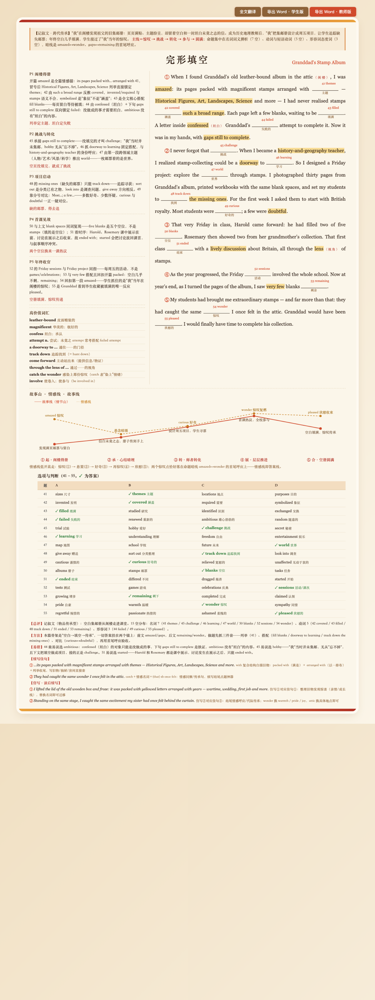
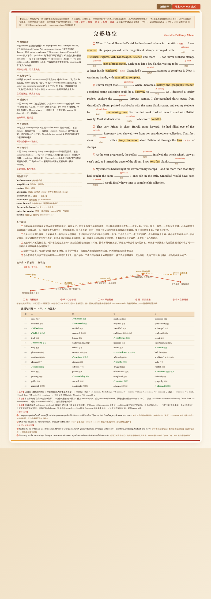

# 完形填空一页式全景批注讲义 / Cloze Panorama Sheet


**作者：Fred老师（公众号：佛瑞德英语教学）**

把一篇完形填空（原文＋15 空＋选项＋答案）灌成一张**一页式全景批注讲义**：暖米色版式，浏览器打开即用，顶部一键导出 Word（学生版 / 教师版）。讲义按「讲」的顺序组织版面，不按"题目顺序"堆砌——学生视线不离开原文，就能完成"空 → 答案 → 词义"三角对照。

## 预览

**全景版面（默认态）**



**点击顶部「全文翻译」按钮，展开逐段对照译文（再点收起）**



## 版面六区

| 区带 | 内容 |
|---|---|
| 横幅 | 【体裁】梗概 ＋ 五词主线链 ＋ 命题焦点 |
| 左栏 38% | P1–P5 意义段（解题路径＋口诀 punch）＋ 高价值词汇 8–10 条 |
| 正文 | 每段 ①–⑤ 段标；空格三层批注（上悬红字答案 / 空格 / 下悬中文义）；黄底高亮线索词；红色小注 |
| 故事山 | SVG：实线情节山（起承转合）＋ 虚线情感线，底部五阶段名 |
| 选项表 | ✓ 绿标答案位（英中对照），右移缩进、疏朗行距 |
| 复盘 | 总评 → 方法 → 易错 ＋ 续写佳句 2 句（每句配 1 句读后续写仿写） |

## 安装

复制整个目录到 WorkBuddy 技能目录：

```bash
cp -r . ~/.workbuddy/skills/fredgao-cloze-panorama-sheet/
```

## 使用

```bash
python3 build_sheet.py data.json out.html
```

`data.json` 按 `SKILL.md` 中的数据契约填写（11 个字段、5 种 passage token）。构建器内置服务端自检：题号连续、正文空数=选项行数=空序一致、答案合法、左栏恰 5 段、故事山阶段数=正文段数、佳句 2 句且每句自带仿写——不通过则 exit 2 逐条报错。

渲染后的 HTML 还有**第二重自检**（页面顶部黄色警告条，只上屏不打印）。

**Word 导出**：顶部两个按钮各生成一份 .doc（Word HTML 格式，Word/WPS 直接打开）——
- **学生版**：标题＋题干下划线空格＋选项表，无答案、无高亮、无中文释义
- **教师版**：全内容（横幅、带红色答案批注的正文、意义段解析、故事山文字版、✓选项表、高价值词汇、复盘、佳句仿写、全文翻译）

两版正文统一：首行缩进 2 字符、1.5 倍行距、两端对齐、A4 页面。浏览器打印仍可出 A4 讲义（1080px 设计宽 zoom 0.64 缩 A4 单页）。

## 设计原理（三句话版）

1. **数据与渲染分离**：HTML 只是壳，全部内容在一段 JSON 里，换一篇完形零改模板
2. **情感线即答案线**：故事山/情感线的首尾点必须与命题暗线（首段情感词 ↔ 末段情感词）同构
3. **双重自检兜底**：结构通过 ≠ 成品通过，任何改动后必须重新全量渲染逐页查验

## License

CC BY-NC-SA 4.0 —— 非商业用途可自由分享与改编，署名 Fred老师（公众号：佛瑞德英语教学）。
